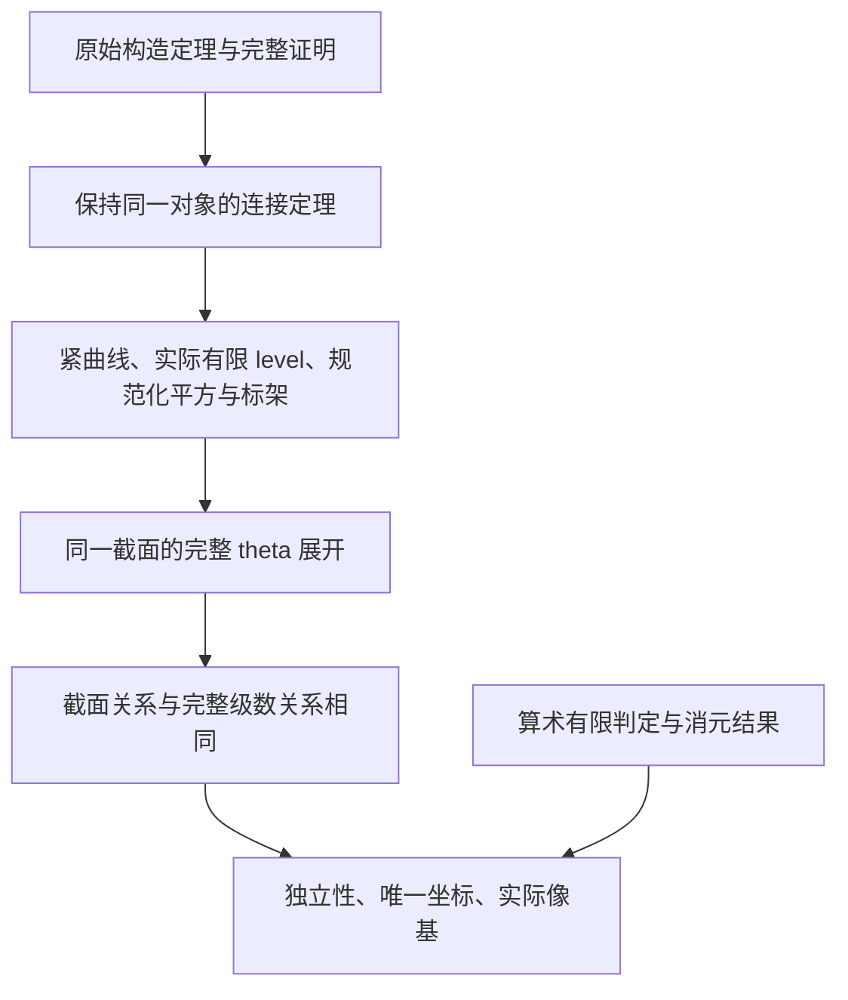

# 数学审阅导引：算术 theta 级数的有限判定与模性

这一层的目的，是让审阅者先核对论文结论中的数学对象，再沿着明确的连接定理查看它们如何由原始构造得到。原始 1,199 个 Lean 模块、103 项冻结检查以及 Palomar 适配版本全部保留；这一层没有重写论文，也没有以新假设代替旧证明。

## 1. 建议首先核对的三个陈述

| 入口 | 对应论文内容 | 建议核对的重点 |
| --- | --- | --- |
| `ArithmeticThetaReview.Geometry.conservative_image_review` | 第 2 节 Arithmetic finite-coefficient determination；第 11 节 One modular family for all certified conservative prefixes | 原有保守界、全部较大截断下的核和像、零秩情况；存在同一个几何族服务于全部截断 |
| `ArithmeticThetaSharpKernelR0195.sharp_matrix_kernel` | 第 9 节 A smaller arithmetic finite-coefficient bound | 原有 sharp 界及完整复 theta 关系的有限判定；此陈述未修改 |
| `ArithmeticThetaReview.Geometry.cyclotomic_modularity_review` | 第 9 节 Arithmetic modularity and the image basis；第 10 节 Scope of the arithmetic modular-form conclusion | 指定分圆系数域、真正的有限 metaplectic level、紧化上的正则截面、规范化完整展开和像基 |

新陈述位于 [ReviewMainTheorems.lean](Lean/ReviewMainTheorems.lean)，原 sharp 定理位于 [SharpMatrixKernelR0195.lean](../Lean/SharpMatrixKernelR0195.lean)。论文标签为 `main`、`sharper-bound`、`arithmetic-modularity`、`scope`，可在 [论文源码](../publication/Paper.tex) 中定位；章节编号随论文排版可能调整，应优先使用标题和标签。

数学家的 v1 审查已核对的是原定理 1 的有限判定部分以及原定理 2 的陈述。本次新增接口及其自动验证不等于几何部分已经通过独立数学家语义审查。

## 2. 先读结论所需的对象，再看构造

令输入为同秩的有限有效 Gram 矩阵族 (A_i)。原始 theta 级数是完整形式幂级数；其系数仍是实际格点表示数。没有用有限多项式替代它，也没有把算术几何模形式替换为解析上半平面函数。

几何审阅接口中只需先辨认以下四个定义；它们的所有字段均可在 [ReviewGeometryDefinitions.lean](Lean/ReviewGeometryDefinitions.lean) 中直接阅读。

| 定义 | 数学含义 | 不能略过的字段 |
| --- | --- | --- |
| `FiniteLevel` | 类映射的每个概形测试拉回都由有限 étale 概形表示 | 任意测试概形及测试映射；两个实际投影、自然性、实际投影的秩界；带锚定的拉回比较 |
| `CompactCurve` | 光滑、适当、整的紧曲线及半权可逆层，带有稠密开部上的实际模对象 | 结构态射；`proper`、`smooth`、`integral`；实际 elliptic family 的 cotangent 平方根；根线恰为紧化线的限制；实际 fpqc stack 及 tautological line |
| `FramedFamily` | 同一紧曲线上的 theta 截面族和指定的形式盘、标架 | 正则全局截面；盘的支配性及其系数域结构态射；真实标架；与同一平方同构连接的规范化资料 |
| `Realizes` | 在该标架中，几何拉回恰好给出 theta 级数的完整展开 | 所有线性组合；由结构态射产生的标量作用；完整恒等式与字面代换 (q=t^L) |

`CompactCurve.object` 使用原有实际模对象：椭圆族、完整 level 标记，以及其实际 cotangent 的平方根。它不是任意命名为“模形式”的线丛。`FiniteLevel` 的纤维表示也保留实际范畴等价和自然性，不只检查几何点上的计数。

截面空间是紧曲线上相应张量幂层的全局截面，因此正则性包含紧化边界。展开通过 `pullbackPowerSection` 和原有结构标量进行，未使用任意指定的线性泛函。

## 3. 为什么规范化没有被藏在一个任意同构中

[ReviewNormalizationDefinitions.lean](Lean/ReviewNormalizationDefinitions.lean) 单独表达下列数学内容，后续可以独立审阅和复用。

| 定义 | 实际约束 |
| --- | --- |
| `schemeFamily` | 同一个仿射椭圆族的概形视角；曲线、结构映射、群运算和几何性质不变 |
| `TateChart` | 真实的椭圆族、level 标记、pointed Cartesian Tate 测试和紧化盘；使用指定 Tate 曲线及微分 |
| `TateChart.comparison` | 由实际拉回、指定交换三角和原有微分比较拼接而成的同构；不是自由参数 |
| `CanonicalCotangent` | 实际单位理想包含与 conormal 微分的规范化方程，固定 Hodge-to-cotangent 比较 |
| `restrictedSquare` | 把同一个紧化平方同构限制到实际开部 |
| `InteriorLink` | 曲线拉回、原点、两个 level 标记、群乘法、canonical cotangent 比较，以及同一个根平方同构的交换方程 |
| `NormalizedFrame` | 标架平方等于正则 Hodge 生成元；生成元在穿孔盘上等于指定的规范化 Tate 微分 |
| `FrameNormalization` | 将上述资料绑定到同一个紧化线、开部对象、形式盘和标架 |

`InteriorLink.square_eq` 是实质性连接：不能只证明两条线同构，而让它们的平方映射相差未说明的单位。`CanonicalCotangent` 又排除了在微分比较中自由乘以标量的做法。

两项 [规范化连接定理](Lean/ReviewNormalizationBridges.lean) 用 `rfl` 证明：新接口的完整比较同构等于原来的 `diskGenericIso`，且紧化映射、紧化平方、生成元、指定微分均为原始字段。这些不是新选出的“性质类似”的对象。

## 4. 同一个几何族与所有截断界

两项新主定理的量词顺序仍为

\[
\exists F,\quad \operatorname{Realizes}(F,A)\ \land\
\forall B\ge B_0,\quad \operatorname{SectionImage}(F,A,B).
\]

没有改写成“每个 (B) 各自存在一个 (F_B)”。保守版还保留原来的零秩结论、`CutoffSpecification`、全部 `PrefixDeterminesKernel` 和 `CertifiedImageData`。

系数域仍为由原矩阵族决定的 (\mathbb Q(\zeta_L))，有限维性仍由原定理证明。截面上的标量仍来自显示的 `structureMap`。

接口中的有限 level 秩界写为 (2\cdot2^{r-1})。前面的 2 来自平方根 torsor 在实际 metaplectic 纤维中的秩；它不是更改论文的 sharp 系数界。`cutoff A` 保持原值。

## 5. 原构造与新接口之间具体保留了什么

`matrix_family_review` 接受原有 `MatrixData` 与已证明的 `ActualLevel`，构造一个审阅族，并证明：

1. 完整展开成立。
2. 对任意截断界，新旧 `SectionImage` 命题等价。
3. 原曲线、结构态射、半权线、盘、标架、截面、紧化平方及规范化生成元保持不变。

其中 `HEq` 仅处理字段所在类型依赖于前序字段的情形；它不是“同构即可”的弱化。这里的源字段实际上按原样装入新记录。

**新主定理是原始较强构造结果的推论，并非整个原始记录的双向等价改写。** 原始记录还显式提供具体纤维构造、torsor、`UsesFiber`、条件满射性、精确秩等式、unary/coset 分解及其他构造证据。新的公共有限 level 接口提取的是表示性、有限 étale 性和秩界。上述较强资料仍完整保留在原定理、源码及原审计中；本次没有证明可从一个任意新记录反向重建全部算法中间产物。

因此，减少审阅依赖来自有证明支持的数学接口分层，而不是宣称原构造中的所有细节已变得不重要。审查构造细节时仍可进入原始定理。

## 6. 可复用的关系传递和公共算术参数

[ReviewRelationLinear.lean](Lean/ReviewRelationLinear.lean) 证明一般加法映射的结论：若 (f,g) 有完全相同的零关系，则 (f(x)=f(y)\iff g(x)=g(y))，同一个系数参数化下的独立性与唯一表示也双向传递。这两项陈述没有项目自定义几何定义。

[ReviewRelationSections.lean](Lean/ReviewRelationSections.lean) 将其应用到任意实际结构态射、模层和截面，保留原有 `baseScalar`、主元索引及有理重构坐标。它以完整级数关系等价和已证明的 `SeriesImage` 为输入，推出原 `SectionImage` 的全部六项结论。几何关系等价仍需由真实展开证明提供；这个通用传递定理本身不是模性构造定理。

[公共算术参数](Lean/ReviewArithmeticDefinitions.lean) 和 [九项连接定理](Lean/ReviewArithmeticBridges.lean) 精确核对数学家指出的重复 API：`norms/normSet`、`normCount/distinctNormCount`、共同 LCM、level、指数、`I(L)` 与有限 `SL₂` 基数及可执行表达。保守界与 sharp 界没有被合并。

## 7. 如何判断实际改善及其边界

同一工具、同一编译环境中的递归陈述依赖计数为：

| 陈述 | 原始自定义定义数 | 新陈述自定义定义数 |
| --- | ---: | ---: |
| 保守界、核、像及几何族 | 340 | 224 |
| 分圆系数域上的模性及像 | 317 | 188 |

减少分别为 116 个（34.1%）与 129 个（40.7%）。简称仍会展开、结构的全部字段类型仍会递归访问，因此不是只增加一个包装名称得到的数字。完整计数约定和逐项依赖见 [工具说明](scripts/DEFINITION_METRIC.md)、[测量报告](verification/DefinitionDependencyReport.json) 和 [225 项联合定义索引](DEFINITION_INDEX.md)。

这些数字不是证明项压缩率，也不是人工审核完成率。新增的是可独立核对、可复用的接口；原始证明并未缩短。新陈述仍然包含相当多的代数几何内容，是否已足够便利应由数学家继续审阅判断，不能仅凭计数或编译成功宣布人工语义审查已经完成。
